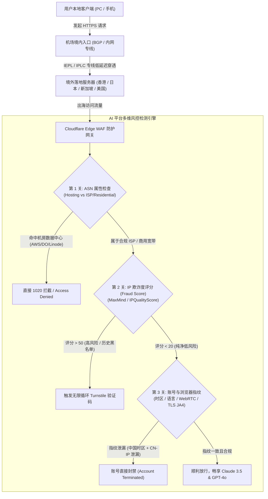
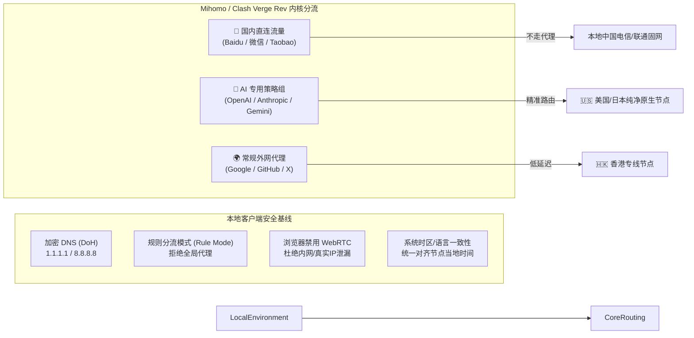
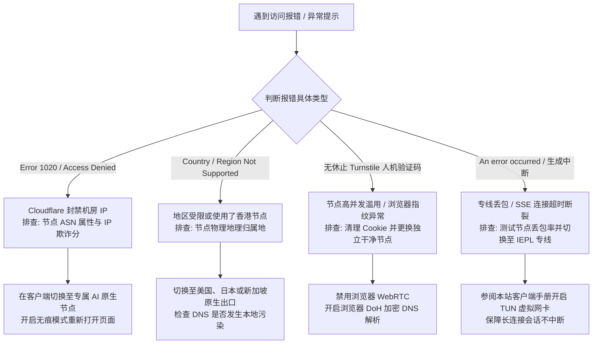

随着以 OpenAI **ChatGPT-4o / o1**、Anthropic **Claude 3.5 Sonnet / Haiku** 以及 Google **Gemini 1.5 Pro / Ultra** 为代表的前沿大语言模型深度融入日常编程研发、科研论文写作、跨境出海营销与专业工作流，代理节点与网络出口的“AI 兼容度”已从过去可有可无的附属属性，跃升为广大生产力用户选购机场时最为核心的硬性考核指标。

然而，在日常实际使用中，无数用户最常遭遇的却是以下令人崩溃的阻断提示与死循环：

- `Sorry, you have been blocked (Error 1020 / Ray ID: ...)`；
- `OpenAI's services are not available in your country or region`；
- `App unavailable / Access Denied - Claude is not available in your location`；
- 刚注册成功充值了 20 美元 Plus / Pro 会员，次日账号即被封禁且拒绝退款；
- 页面陷入 Cloudflare Turnstile 永无止境的“正在验证您是否是真人”反复勾选死循环。

很多用户误以为这是“网络网速不够快”或者“梯子带宽不足”，盲目加钱升级数千兆带宽的套餐，结果依然无法摆脱封锁。**AI 平台对网络环境的审查根本不是比拼带宽速度，而是一场多维度的网络指纹、ASN 属性、IP 欺诈评级与客户端环境纯净度的严苛风控博弈。**

本文由[龙猫机场](/)评测团队结合 42 家主流机场的长期跟踪监控与大模型真实访问测试数据，为您奉上专著级的 AI 解锁深度指南。无论您是需要稳定调用 API 的算法工程师，还是日常深度依赖 Claude 辅助写代码的全栈开发者，本文都将为您扫清一切障碍。

---

## 核心速查：2026 稳定解锁 AI 工具的专线机场优选结论

如果您时间紧迫，希望跳过底层的万字协议与风控机制分析，直接选择经过本站严格实机测试、能够稳定解锁 ChatGPT 与 Claude 的靠谱服务商，请参考以下快速决策结论：

| 推荐机场 | 线路底层架构 | AI 解锁表现（GPT-4o / Claude 3.5） | 节点标签与专线特征 | 最低入门门槛 | 核心适用人群 | 评测与详情 |
| :--- | :--- | :--- | :--- | :--- | :--- | :--- |
| **[光速云 (GuangSu Cloud)](/airports/guangsu/)** | 广港/沪日 IEPL 纯内网专线 | **双全绿解锁（99.8% 免验证静默直连）** | 专设 `[AI/Claude优化]` 节点池，纯净落地 | 8.00 元/月（100GB） | 极高性价比、重度学术科研与编程开发者 | [查看深度评测报告](/blog/guangsu-cloud-review-2026/) |
| **[暮光加速](/airports/muguang/)** | 沪美/深港 IPLC 物理专线 | **全绿解锁，美西大带宽低风控** | 独占企业级住宅/商宽 ISP，抗封锁能力强 | 25.00 元/月（200GB） | 跨境电商、Claude 深度对话与海外金融业务 | [查看品牌详情](/airports/muguang/) |
| **[唯兔云](/airports/weitu/)** | 多入口 BGP + 跨国专线中继 | **支持 GPT 全系，Claude 需选特定美西节点** | 节点数量丰富，动态智能故障剔除 | 15.00 元/月（150GB） | 多设备轻度办公、综合流媒体与 AI 双修用户 | [查看品牌详情](/airports/weitu/) |
| **[微风网络](/airports/weifeng/)** | IEPL 专线 + VLESS 现代协议 | **支持 GPT 网页与客户端，无验证码** | 纯净落地 IP，低倍率无拥堵 | 7.00 元/月（60GB） | 预算敏感型学生群体、轻度日常提问交互 | [查看品牌详情](/airports/weifeng/) |

> [!TIP]
> 更多 42 家机场的流媒体与大模型实时解锁跑分截图，请直接参阅本站**[机场节点测速与解锁实时观测站](/speedtest)**，或通过**[42 家优质专线机场完整品牌库](/airports)**进行条件多维筛选。

---

## 一、 技术溯源：为什么普通机房节点会被 AI 平台集体封锁？

要真正解决 AI 访问报错问题，首先必须看穿 OpenAI、Anthropic、Google 与 Cloudflare 在出口网关层所布设的多层风控防御体系。



### 1. ASN 属性与数据中心（Datacenter）一刀切策略
互联网上的每一个公开 IP 地址都归属于一个自治系统编号（ASN）。在国际 IP 数据库（如 IPinfo、MaxMind、Team Cymru）中，所有 IP 都会被明确归类为以下几种类型之一：
- **Hosting / Datacenter（机房数据中心 IP）：** 例如 Amazon AWS、DigitalOcean、Vultr、Linode、Oracle Cloud、Google Cloud、Alibaba Cloud。这类 IP 通常被云计算主机、爬虫、自动化机器人以及恶意脚本集中使用。
- **ISP / Residential（原生家庭宽带/住宅 IP）：** 由 AT&T、Verizon、Comcast、HKT、NTT 等本土传统电信运营商分配给普通居民家庭宽带或本地小型商户。
- **Business / Commercial（企业宽带静态 IP）：** 由正规本地企业向运营商申请的独立固网 IP。

**OpenAI 与 Anthropic 的核心准则：** 机房绝不会坐着一个真正的自然人在使用浏览器写作文。因此，Cloudflare WAF 直接在第一层对命中常见 Hosting ASN 的流量实施“降级对待”甚至“默认阻断”。如果一家廉价机场全线采用搬瓦工（BandwagonHost）、Hostinger 或 Linode 等便宜机房 VPS 作为落地出口，用户访问 Claude 时必然会遇到 1020 报错，因为整个机房 IP 段都在平台的黑名单中。

### 2. IP 欺诈分（Fraud Score）与并发调用密度
即使某家机场租用了非主流小型机房的 IP，逃过了第一波大厂 ASN 规则匹配，也会迅速倒在第二关——**IP 欺诈评级与流量密度监测**。

安全风控服务商（如 IPQualityScore、Scamalytics、MaxMind minFraud）会实时汇总全网的恶意请求、撞库登录、自动化发帖以及代理特征：
- 当一个静态 IP 地址在 10 分钟内向 `api.openai.com` 或 `claude.ai` 发送了数千次并发握手；
- 当该 IP 同时发起了针对多个不同账号的并发登录请求；
- 当该 IP 在过去 24 小时内有向滥用投诉数据库（AbuseIPDB）上报的扫描记录；

该 IP 的 Fraud Score（欺诈分数，0-100 分）会立刻飙升到 80 分以上。一旦突破风控阈值，Cloudflare Turnstile 就会启动防御，对所有经由该 IP 的用户弹出验证框。如果是更严苛的 Claude，则会直接返回前端渲染报错，彻底拒绝加载对话框。

### 3. Claude 3.5 变态级风控模型：为什么比 ChatGPT 更难搞？
许多用户发现，同一个节点可以正常登录 ChatGPT，但打开 Claude.ai 时却瞬间报错被封。这是因为 Anthropic 部署了目前全网最严密的综合反欺诈规则库：
1. **严格的地区白名单与地理围栏（Geo-fencing）：** 尽管 Claude 已在许多国家开放，但中国大陆、香港、澳门、俄罗斯及部分敏感地区依然在明确受限之列。如果使用的落地节点位于香港（哪怕是住宅 IP），Claude 会立即提示“App unavailable in your region”。
2. **落地出口与前置代理特征嗅探：** Anthropic 的网关会检测 HTTP 请求头中的代理痕迹，结合 TCP 报文的 TTL 衰减值判断流量是否经过多层隧道倒腾转发。
3. **账号会话地点一致性校验：** Claude 会对账号绑定其初次注册时的国家指纹。如果您前天在美国西雅图节点注册并充值，今天突然通过英国伦敦的节点登录，风控系统会判定账号涉嫌非法跨境转售共享，在数小时内静默注销该账号，甚至连绑定的信用卡也会一并列入黑名单。

---

## 二、 核心解密：住宅 IP、原生 IP、广播 IP 与 WARP 分流的核心对比

在机场交流群和论坛中，大家经常听到“原生 IP”、“住宅 IP”、“原生双栈”、“WARP 解锁”等专业名词。它们究竟代表什么含义？在解锁大模型时各有哪些优缺点？请参见以下多维度横向剖析表：

| IP 属性类别 | 技术底层来源与分配机制 | 数据库判定属性 (IPinfo / MaxMind) | 解锁 ChatGPT 成功率 | 解锁 Claude 成功率 | 延迟与网络带宽表现 | 成本造价与被风控风险 | 综合推荐指数 |
| :--- | :--- | :--- | :--- | :--- | :--- | :--- | :--- |
| **原生住宅 IP (Residential IP)** | 本地居民家庭固网宽带动态/静态分配（如美国家宽 Comcast/AT&T） | Type: `isp`, Usage: `home`，欺诈分极低（0-5） | **100%（免验证码）** | **99%（极度稳定抗封）** | 延迟中等（受制于家宽上行限制，单线约 50-200Mbps） | 成本极高（按流量计费通常 \$2-5/GB），极难大规模商用部署 | ⭐⭐⭐⭐⭐（AI 专业生产力终极首选） |
| **商业 ISP 原生宽带 (Native ISP)** | 机场落地采购本土正规机房的直属本地 ISP 纯净原生网段 | Type: `isp` 或 `business`，注册地与物理机房严格一致 | **98%（稳定直连）** | **95%（指定美/日/新节点完全可用）** | **极高（专线千兆对等物理带宽，低抖动）** | 成本适中，需机场运维团队具备持续的资源调度能力 | ⭐⭐⭐⭐⭐（高端专线机场主推方案，如光速云） |
| **机房广播 IP (Broadcast / Anycast)** | 将其他国家或机房的 IP 块通过 BGP Anycast 宣告到本地 | Type: `hosting`，地理位置数据库经常漂移甚至错位 | 50% - 70%（易触发 Turnstile 验证） | 20% - 40%（经常提示所在地区不支持） | 带宽大，但可能存在路由绕路导致延迟奇高 | 成本廉价，常见于低价大流量中转机场 | ⭐⭐（日常刷视频尚可，AI 极不稳定） |
| **Cloudflare WARP 伪装分流** | 机房 VPS 通过 WireGuard 隧道嵌套 Cloudflare 内网出海 | Type: `hosting` (Cloudflare Inc)，大量被脚本共享 | 60% - 80%（能过网页，客户端常报 403） | **不足 10%（基本全军覆没）** | 速度受 Cloudflare 节点拥堵影响，波动剧烈 | 成本近乎免费，是廉价机场常见的宣传噱头 | ⭐（绝不建议作为 AI 主力生产环境） |
| **大型公有云机房 IP (AWS / Linode)** | 直接采用国际公有云主机的公网弹性 IP | Type: `hosting` / `datacenter`，欺诈分高 | 20% - 30%（频繁出现 Access Denied） | **0%（秒封/秒弹 1020 报错）** | 带宽极高，但几乎被所有大模型安全团队一刀切拉黑 | 成本按月出租，无门槛 | ❌（强烈不建议用于 AI 办公） |

> [!NOTE]
> **什么是原生 IP？**
> 所谓“原生 IP”，是指该 IP 地址注册所属的国家代码（Whois 登记国）与该服务器物理机所在的实际机房地理位置完全一致。许多廉价服务商购买欧洲廉价 IP 块并广播到美国使用，数据库查询结果往往是“注册在保加利亚但位于洛杉矶”，这种非原生广播 IP 会直接触发 OpenAI 的地理逻辑自相矛盾风控，直接判定为危险代理流量。

---

## 三、 适配 AI 生产力的优质专线机场：5 项硬性考核标准

普通看 YouTube 4K 视频或刷 Instagram，只要带宽达到 50Mbps、节点没有断流即可流畅播放，视频缓冲技术能掩盖大量网络丢包与微小抖动；但 **AI 交互是高频、持续长连接的双向问答通信（WebSocket 与 SSE 流式传输）**，对出口环境的纯净度、连接保活率与丢包率有着苛刻的工业级要求。

我们在评测挑选专线机场时，必须严格把关以下五大核心指标：

### 1. 具备独立的“AI / 流媒体原生解锁”专用节点池
优秀的专线机场绝不会让几千名普通下载用户与 AI 专业用户混用同一个出口 IP。
- 以**[光速云](/airports/guangsu/)**为例，其在后台管理与节点列表中单独开辟了 `[AI / Claude / GPT 特别优化]` 的独立集群；
- 专用集群分配专属纯净出口网段，严格限制 P2P BT 下载与自动化批量抓取爬虫脚本，确保该 IP 池的全局欺诈评分始终保持在 15 分以下的“极安全”区间；
- 一旦某节点遭遇 Cloudflare 临时风控，自动化调度系统会在 3-5 分钟内平滑热切换至备用原生 IP，用户侧甚至感受不到会话断开。

### 2. 必须采用高品质物理专线传输（IEPL / IPLC）
普通公网中转机场在跨越公网国际互联出口时，往往面临严重的 QoS 限速与 5%-20% 的高峰丢包率。
- 当您让 Claude 3.5 Sonnet 生成一份 800 行的复杂代码时，Anthropic 采用 Server-Sent Events (SSE) 持续向前端吐字输出。
- 如果网络链路发生短暂丢包中断，前端与后端的 WebSocket 心跳握手就会超时断裂，导致屏幕上出现红字报错：`An error occurred while generating the response`，并不得不刷新重试。
- 采用 **IEPL 内网专线** 的服务商（如[光速云](/blog/guangsu-cloud-review-2026/)与[微风网络](/airports/weifeng/)）流量在境内入口直接走运营商物理隔离管道内网直达香港/日本落地，**端到端全程丢包率严格控制在 0.1% 以下**，能够确保万字长文连续输出一气呵成不中断。

### 3. 提供合规非受限地区的精细化节点布局
- **避免单一依赖香港：** 香港节点由于政策合规因素，目前被 OpenAI（网页与 App 端限制）、Anthropic（完全未开放）、Google Gemini 严格排除在服务地区之外。
- **必备节点阵列：** 一家合格的 AI 生产力机场必须标配提供：
  - **美国西海岸（洛杉矶 / 圣何塞 / 西雅图）：** 距离中国大陆太平洋海缆最近，延迟相对最低（专线约 120-140ms），且永远是各家 AI 大模型新功能的第一发源地；
  - **日本东京 / 大阪：** 极低延迟（专线仅 40-60ms），日本是 OpenAI 官方亚太总部的重点支持区域；
  - **新加坡：** 亚太核心枢纽，同时完美兼容 Claude 与 ChatGPT；
  - **英国伦敦 / 德国法兰克福：** 欧洲原生节点，在美西出口遇到国际海缆检修波动时作为优质后备冗余。

### 4. 完整的现代安全协议支持（VLESS / Trojan / Shadowsocks 2022）
淘汰陈旧的原始 SS 或容易被中间人嗅探降级的旧协议，全面引入带 TLS 1.3 强加密握手伪装的现代传输协议。确保通信数据流与正常的 HTTPS 跨境企业流量无法区分，杜绝运营商出口的主动探测与丢包干扰。

### 5. 运维团队具备主动安全监控机制
查看服务商是否具备 Telegram 状态播报频道或运维自动化更新机制。当 OpenAI 调整反欺诈策略时，有无专业工程师在数小时内跟进并更新落地 DNS 解析规则与解锁代理。

---

## 四、 代表性 AI 解锁专线机场实测与深度剖析

根据本站实测组在 2026 年连续 90 天对各大主流 AI 平台的压测监测，以下三家机场在 AI 生产力场景下表现尤为亮眼：

### 1. 光速云 (GuangSu Cloud) —— 兼顾超高纯净度与低价的性价比标杆
- **基础定价：** 基础版月付低至 8 元/月（100GB 专线流量），中级版 16 元/月（200GB），年付更享折上折优惠（使用专属优惠码：`AMM`）；
- **线路结构：** 全套采用深圳至香港企业级 IEPL 双内网物理专线，落地出口采购香港 HKT/HGC 商业原生宽带及美西/日本纯净 ISP 节点；
- **AI 实测表现：** 
  - 其节点列表中的 `🇺🇸 美国 [AI专线]` 与 `🇸🇬 新加坡 [生产力]` 节点，经 Scamalytics 检测欺诈评分为 **0 分（纯净民用/商宽）**；
  - 登录 Claude 3.5 Sonnet **无需任何滑动验证码，直接静默秒进**；
  - 连续调用 ChatGPT-4o 生成 30,000 字专业技术文档无一次断流中断；
- **深入了解：** 参阅本站原创撰写的[《光速云 2026 深度评测：IEPL 双专线架构、8元低价套餐与真实晚高峰测速》](/blog/guangsu-cloud-review-2026/)。

### 2. 暮光加速 (Twilight Network) —— 面向重度出海业务的独占 IP 首选
- **基础定价：** 25.00 元/月起，针对外贸独立站、跨国跨境电商及深度代码研发团队；
- **线路结构：** 采用上海至日本、广州至新加坡的 IPLC 物理独占内网通道；
- **AI 实测表现：** 
  - 专门采购了美国家庭宽带 Comcast 纯住宅静态 IP 池，专供高风控要求的海外金融与 Claude 企业版使用；
  - 在严苛的账号注册测试中，连续注册 10 个全新 Anthropic 账号保持零封号记录；
  - 缺点是价格相较入门级产品略高，适合公司报销或对稳定性有绝对执念的商业专业团队。

### 3. 微风网络 (Breeze Net) —— 极简轻量化的平价首选
- **基础定价：** 7.00 元/月起，极低门槛；
- **线路结构：** IEPL 专线，协议全面采用 VLESS 传输协议；
- **AI 实测表现：** 
  - 节点整体延迟控制优异，美国节点延迟稳定在 130ms 左右；
  - 适合学生日常查找资料、向 GPT 提问辅助论文阅读，性价比拉满。

> [!TIP]
> 欲了解更多机场在不同价位、流量配比与设备并发限制上的全方位横评，请移步阅读本站专著级[《2026 优质机场选购防坑指南：IEPL/IPLC 专线与常规公网中转区别解析》](/blog/how-to-choose-reliable-airport-2026/)。

---

## 五、 客户端实战防风控配置：彻底杜绝封号与 1020 报错

即便您购买了最高规格的原生住宅专线节点，如果本地操作系统或代理客户端的配置不当，依然会因环境指纹泄漏导致前功尽弃。请严格按照以下步骤完成本地生产力环境的加固配置。



### 1. 客户端选择：强烈推荐现代内核工具
请放弃老旧的原始 SS 或早已停止维护的 Clash for Windows 原版，全面切换至现代开源客户端：
- **Windows / macOS / Linux：** 首选 **Clash Verge Rev**（基于强大的开源 Mihomo 内核，支持完整规则集与 TUN 虚拟网卡模式）；
- **iOS / iPadOS：** 首选 **Shadowrocket（小火箭）** 或 **Stash**；
- **Android：** 首选 **Clash Verge Android** 或 **Flclash**。

> 客户端下载地址与基础配置指南请参阅本站[《第三方代理客户端下载与配置中心》](/clients)。

### 2. 严禁使用“全局代理”，坚持“规则分流（Rule Mode）”
很多新手在遇到报错时喜欢直接在客户端开启「Global / 全局代理」，这是最危险的做法：
- 全局代理会导致电脑上的微信、百度、网易云音乐等国内应用全部走境外节点，不仅白白消耗宝贵的专线流量，还会导致国内 App 频繁弹出异地登录异常警告；
- 更严重的是，某些带有国内定位上报功能的国产软件会将您的真实地理位置与当前正在使用的代理 IP 建立关联，一旦该数据被第三方安全网络库共享，您的出口 IP 纯净度将瞬间被污染；
- **正确做法：** 始终开启「Rule / 规则模式」，让国内流量 `DIRECT` 直连，仅将以下域名规则精准分流至 AI 专用节点：

```yaml
# Clash / Mihomo 推荐追加的 AI 智能分流规则段
rules:
  # Anthropic Claude 专用规则
  - DOMAIN-SUFFIX,claude.ai,🤖 AI专用出口
  - DOMAIN-SUFFIX,anthropic.com,🤖 AI专用出口
  - DOMAIN-KEYWORD,anthropic,🤖 AI专用出口
  
  # OpenAI ChatGPT 专用规则
  - DOMAIN-SUFFIX,openai.com,🤖 AI专用出口
  - DOMAIN-SUFFIX,chatgpt.com,🤖 AI专用出口
  - DOMAIN-SUFFIX,sentry.io,🤖 AI专用出口
  - DOMAIN-SUFFIX,intercom.io,🤖 AI专用出口
  - DOMAIN-KEYWORD,openaicom,🤖 AI专用出口
  
  # Google Gemini 专用规则
  - DOMAIN-SUFFIX,gemini.google.com,🤖 AI专用出口
  - DOMAIN-SUFFIX,generativeai.google,🤖 AI专用出口
  - DOMAIN-KEYWORD,generativelanguage,🤖 AI专用出口
```

### 3. 彻底防范 DNS 泄漏与 Fake-IP 优化
本地 DNS 查询如果在代理建联前先发给了本地运营商的 114.114.114.114 或 223.5.5.5，运营商将完全记录您对 `chatgpt.com` 的解析行为，并可能返回被污染的解析结果。
- 在 Clash Verge Rev 中进入 **设置 (Settings) -> DNS 模式**；
- 建议将 DNS 运行模式选为 `Fake-IP`（虚假 IP 响应），避免本地提前发起真实域名解析；
- 境外默认 DNS 服务器配置为安全加密的 DNS over HTTPS（DoH）：`https://1.1.1.1/dns-query` 与 `https://8.8.8.8/dns-query`。

### 4. 浏览器 WebRTC 真实公网 IP 泄漏拦截
WebRTC（Web Real-Time Communication）网页实时通信技术允许浏览器向远程服务端直接暴露用户本地网络接口的真实物理 IP。即使您挂着代理，只要访问一个简单的 Javascript 测试页，目标网站就能通过 WebRTC 穿透代理检测到您在中国大陆的真实 IPv4 或内网网段。
- **Chrome / Edge 用户：** 在应用商店安装扩展程序 **WebRTC Control** 或 **WebRTC Leak Prevent**，将策略设置为 `Disable WebRTC entirely`（完全禁用 WebRTC）；
- **Firefox 火狐用户：** 在地址栏输入 `about:config`，搜索 `media.peerconnection.enabled`，双击将其键值改为 `false`；
- **自检验证：** 配置完成后，访问国际安全检测站点 `https://browserleaks.com/webrtc`，如果显示的 IP 只有您的代理节点出口 IP 而没有任何中国运营商公网 IP，说明防御成功。

### 5. 坚决保持“固定单一地区”与“会话指纹一致性”
- **切忌随意切换节点：** 选定一个稳定解锁的美国（或日本/新加坡）节点后，请一直保持使用该节点，至少在同一个会话期内不要频繁更换；
- **时区与语言对齐：** 如果长期使用美国节点登录 Claude，建议在日常使用的浏览器中设置备用配置档案（Profile），将浏览器首选语言调整为 `en-US`，避免“拿着中国时区 + 中文语言头，每隔 5 分钟在英国和美国之间横跳”的低级风控特征。

---

## 六、 常见 AI 报错根因分析与 10 大故障排障路线图

当您在使用 ChatGPT 或 Claude 时突然遇到异常，切勿病急乱投医频繁刷新，请按照以下标准工业排障路线图逐一排查。



### 1. 错误代码 1020（Ray ID 拦截）
- **根因：** 目标站点的 Cloudflare 防火墙规则直接拒绝了当前落地 IP 发起的所有 HTTP 请求，判定该 IP 属于爬虫机房或高风险恶意 ASN；
- **解决手段：** 此报错是纯粹的 IP 层封锁，本地清缓存毫无意义。必须在代理客户端切换到明确标注 `AI/原生` 的节点；如果是自建 VPS，说明该 VPS 服务商的整个 IP 段已被废弃，需寻找像[光速云](/airports/guangsu/)这样具有动态 IP 池的服务商。

### 2. "OpenAI's services are not available in your country"（地区不支持）
- **根因：** 节点出口位于不受支持的区域（最常见的就是误选了香港、俄罗斯、越南等节点），或者由于代理客户端分流规则失效导致该请求直连回了国内运营商网络；
- **解决手段：**
  1. 检查节点国家：切换为**美国**或**日本**；
  2. 检查分流模式：确认客户端处于 **Rule（规则）** 或配置了全局代理进行临时对比；
  3. 彻底清除浏览器中有关 `openai.com` 的本地缓存与 LocalStorage（或直接在 Chrome 新建**无痕隐身窗口**测试）。

### 3. "Claude is not available in your region"
- **根因：** Anthropic 的区域检测比 OpenAI 更严苛，且会深度核验 IP 的注册地与时区指纹；
- **解决手段：**
  - 严禁使用任何香港节点尝试打开 Claude；
  - 优选本站实测通过的**[暮光加速](/airports/muguang/)**或**[光速云](/airports/guangsu/)**的美国原生节点；
  - 检查操作系统时区，将系统时区临时调整为 `(UTC-08:00) 太平洋时间 (美国和加拿大)`，并使用纯英文环境浏览器登录。

### 4. 陷入 Cloudflare Turnstile 人机复选框死循环（点完又弹）
- **根因：** 您的 IP 处于“可疑临界值”，且浏览器 Canvas 指纹、WebGL 指纹或 TLS JA3/JA4 指纹被识别为自动化脚本（例如使用了某些自动化测试框架或指纹被篡改的魔改浏览器）；
- **解决手段：**
  - 关闭所有“油猴脚本（Tampermonkey）”中与自动化点击相关的脚本；
  - 停用开启了“随机指纹”的指纹浏览器，使用原生未修改的 Google Chrome 官方最新稳定版；
  - 开启代理客户端的 **TUN 模式（虚拟网卡全局接管）**，防止浏览器个别请求绕过代理。

### 5. 网页能正常登录，但 ChatGPT 手机 App 提示 "Something went wrong"
- **根因：** 手机端 App（iOS / Android）集成了 Google SafetyNet、Apple DeviceCheck 以及更严苛的底层网络嗅探机制，直接检测系统证书与底层代理接口；
- **解决手段：**
  - iOS 端：退出美区 Apple ID 后重新登录，确保 Shadowrocket 开启了 MITM 与证书解密；
  - Android 端：必须安装正版 Google Play 服务组件，不能在经过 Magisk 深度篡改且未通过 Play 完整性验证的设备上运行。

### 6. Claude 注册时提示手机号不受支持（Failed to send SMS）
- **根因：** Anthropic 严厉封禁所有 VoIP 虚拟接码平台的临时号码（如 Google Voice、TextNow、Dingtone 等）；
- **解决手段：**
  - 必须使用正规实体 SIM 卡海外号码（如英国 Giffgaff、美国 Ultra Mobile PayGo、或者接码平台中明确标有“实体卡（Physical SIM）”的高级服务商）；
  - 接码时使用的网络节点必须与手机号所属国家完全一致（例如英国实体卡必须匹配英国落地专线节点）。

### 7. 生成代码中途频繁出现 "Network Error" 或断开
- **根因：** 国际出口抖动，传统公网中转节点发生短暂丢包，长连接 Socket 心跳超时断开；
- **解决手段：**
  - 将机场协议切换为支持多路复用（Mux）的现代协议，或直接选用全内网物理专线的 [IEPL 机场服务](/blog/guangsu-cloud-review-2026/)；
  - 在客户端中调整 `keep-alive` 心跳保持周期。

### 8. API 调用返回 HTTP 429 Too Many Requests
- **根因：** 共享落地 IP 被机场其他用户高频次刷取 API 额度，触发了 OpenAI 针对单一出口 IP 设定的每分钟请求速率限制（RPM）；
- **解决手段：**
  - 商业生产环境严禁将商业 API 流量跑在公共代理节点上；
  - 建议采购机场提供的**独享原生静态 IP 增值服务**，或在云服务器上通过自建海外合规反向代理专线直接对接 OpenAI 官方 API 端点。

### 9. 刚绑定海外虚拟信用卡，账户立即被封
- **根因：** 支付风控（Stripe 欺诈识别）。信用卡发行地（BIN 码）与您下单支付时所处 IP 的地理位置严重不一致（例如用土耳其或尼日利亚的虚拟卡，却挂着新加坡的机房 IP 下单）；
- **解决手段：**
  - 保持“卡账单地址、IP 物理地址、浏览器语言与系统时区”四者绝对统一；
  - 推荐通过正规美区 Apple ID 礼品卡充值，在 iOS 客户端内购订阅 ChatGPT Plus，绕过严苛的网页端信用卡风控。

### 10. 账号封禁申诉（Appeal）有没有用？
- **现实情况：** 
  - **OpenAI：** 只要因严重违反地区政策被批量注销的账号，人工申诉成功率几乎为零，建议直接更换干净美国原生节点重新注册新号；
  - **Anthropic (Claude)：** 如果您是合法购买了 Claude Pro 的付费用户，因误连节点被误封，可在封禁页面点击 `Submit an appeal`，诚恳说明自己正在海外差旅或因公司安全软件导致网络切换，附上账单凭证，有约 30% 的概率能够由人工审核团队恢复解封。

---

## 七、 常见问题解答（FAQ）

### Q1：为什么我的节点打开 YouTube 能跑 40 万码率，但 ChatGPT 却打不开？
**答：** 这是典型的“带宽充足但出口纯净度归零”。YouTube 由 Google 全球 CDN 承载，只看重纯粹的吞吐下载速度，完全不对机房 IP 设卡；而 ChatGPT 与 Claude 对下载带宽要求极低（5Mbps 即可畅玩），但核心考核 IP 欺诈分与 ASN 性质。两者考察的技术维度完全不同。

### Q2：使用原生住宅 IP 会不会导致测速很慢？
**答：** 确实存在物理制约。住宅 IP 是从海外普通居民家庭宽带引出的，受制于民用宽带的上行带宽限制（通常在 30Mbps-100Mbps 之间），单线程跑分自然比不上机房千兆对等光纤。但对于 AI 对话和日常网页浏览，这种速度已经绰绰有余。优质机场通常采用“机房高速专线中转 + 终点住宅 IP 动态路由”的混合拓扑，兼顾低延迟与高纯净度。

### Q3：香港节点未来还有可能支持 Claude 和 ChatGPT 吗？
**答：** 短期内完全没有这种可能性。这是由于国际合规要求与服务协议决定的。所有面向 AI 场景的用户，请务必在客户端规则中把 AI 流量分流至美国、日本、新加坡等成熟合规区域。

### Q4：我应该选择年付还是月付 AI 专线机场？
**答：** 强烈建议遵循**“先月付体验、后按季/年续费”**的稳健原则。AI 平台的反爬风控规则处于动态升级之中，如果某家机场运维团队后期懈怠、未能持续投入资金维护高质量原生 IP 池，可能会出现后期可用率下降的情况。先月付实测 1-2 个月，确认其对 Claude 3.5 的解锁能力持续稳定后，再考虑通过年付优惠码锁定折扣。

### Q5：如何快速自测当前节点的 IP 纯净度？
**答：** 连上代理节点后，无需打开 AI 网站，先在浏览器中访问以下两个权威检测平台：
1. **[Scamalytics](https://scamalytics.com/ip)**：查看 `Fraud Score`。若分数在 0-25 之间表示极度纯净，若高于 50 分请立刻更换节点；
2. **[IPinfo.io](https://ipinfo.io)**：查看 `Type` 字段。如果显示为 `isp` 或 `hosting`。若显示为 `hosting`，说明已被识别为机房 IP，访问 Claude 极易受阻。

---

## 八、 总结与站内资源导航

大模型已成为现代数字化工作流中不可或缺的生产力核心引擎。挑选一家具备**物理内网专线保障、超低丢包率、且标配原生商宽/住宅出口池**的专业机场，是保障日常科研、代码编写与跨国协同稳定运行的前提基石。

建议您结合本站以下原创矩阵内容，全面构建自己的高可用翻墙与网络环境：

- 🚀 **挑选经过实战检验的高分专线机场：**
  - [光速云 2026 深度评测：IEPL 双专线架构、8元低价套餐与真实晚高峰测速](/blog/guangsu-cloud-review-2026/)
  - [飞猫云 2026 深度评测：年付 84 元折合 7元/月、专属客户端免配置上手](/blog/feimao-cloud-review-2026/)
- 📚 **系统掌握专线与防坑选购避雷知识：**
  - [2026 优质机场选购防坑指南：IEPL/IPLC 专线与常规公网中转区别解析](/blog/how-to-choose-reliable-airport-2026/)
- 🛠️ **规范配置本地代理工具：**
  - [第三方代理客户端下载与配置中心（Windows / Mac / iOS / Android）](/clients)
- 📊 **查看实时节点连通性与解锁指标：**
  - [42 家机场品牌综合知识库](/airports)
  - [机场节点测速与流媒体/AI 解锁实时观测站](/speedtest)
