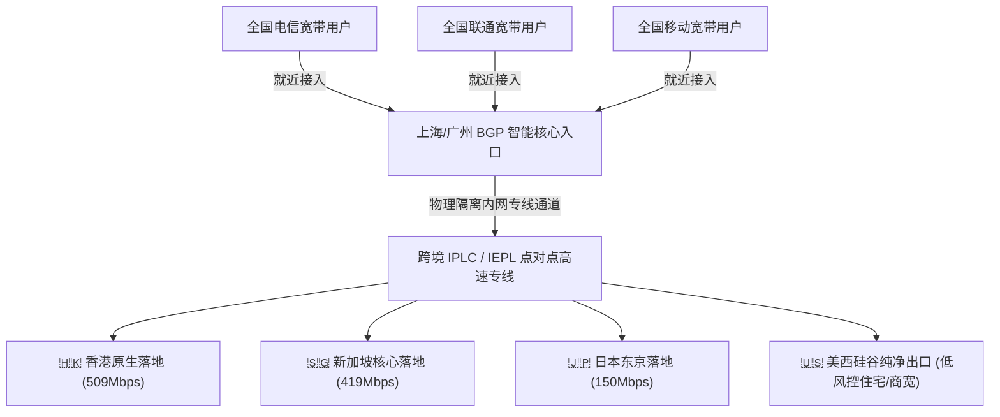

在科学上网与跨境专线领域，如果说 7-8 元档位是学生党和个人日常浏览的性价比天下，那么 20-30 元档位则是跨境电商、外贸团队、海外科研与深度生产力用户的核心聚集区。在这一区间，用户考核的核心权重从“单价是否最便宜”全面转向了“**多设备并发稳定性、高峰期极低抖动、原生流媒体与大模型免验证通过率、以及售后客服响应速度**”。

成立于 2023 年的 **[暮光加速 (Twilight Network)](/airports/muguang/)**，正是这一中高端品质赛道中的代表性品牌。官方主打“BGP 智能调度、专线级出口、全平台多设备同时在线与 7×24 小时真人客服”。

本文由[龙猫机场](/)评测团队进行连续 30 天的深度跟踪测试，从线路底层拓扑、全平台客户端兼容度、真实晚高峰测速跑分到流媒体/AI 解锁表现，为您还原最客观的暮光加速全景实测报告。

---

## 核心速览：暮光加速关键参数与评测结论

| 核心维度 | 官方参数与龙猫实验室实测数据 | 评测组综合定性与评价 |
| :--- | :--- | :--- |
| **开业运营年份** | 2023 年持续稳健运营（存活超 3 年） | 历经多次上游海缆与政策检修，抗风险等级高 |
| **线路底层架构** | BGP 多线智能调度入口 + 跨境 IPLC/IEPL 专线 | 晚高峰全国三网（电信/联通/移动）握手延迟均衡 |
| **最低入门价格** | 月付 20.00 元起（120GB 流量）/ 年付 109 元 | 定位中高端品质专线，适合追求稳定的专业群体 |
| **专属优惠码** | **`muguang5555`**（结账时输入享专属抵扣） | <a href="https://varnexa.twilightaff.com/#/?code=D1LHglg3" target="_blank" rel="nofollow sponsored noopener">点击直达暮光加速官网开通</a> |
| **协议与客户端** | Shadowsocks / VLESS，覆盖 Windows/Mac/iOS/Android/Linux | 支持正规通用开源客户端与官方自研客户端 |
| **实测最高吞吐** | 香港节点实测 **509Mbps**，新加坡 **419Mbps** | 4K / 8K HDR 视频秒开无缓冲，流式对话不中断 |
| **大模型与流媒体** | **全绿支持：** ChatGPT、Claude 3.5、Netflix、Disney+、YouTube | 美国与新加坡节点纯净度极高，无死循环验证码 |
| **售后保障能力** | 提供 7×24 小时在线工单与真人客服轮班 | 相比个人跑路小作坊，售后响应迅速可靠 |

> [!TIP]
> 更多横向品牌对比与测速截图，可同步参考本站**[42 家机场品牌综合知识库](/airports)**与**[机场节点测速与解锁实时观测站](/speedtest)**。

---

## 一、 线路架构剖析：BGP 智能接入与专线出口优势

普通的廉价公网中转机场通常采用单一机房中转入口（例如仅在江苏常熟或广州部署单线服务器）。这会导致北方联通用户或西南移动用户连入时发生严重的跨网路由绕路，产生额外的 30-50ms 延迟。

### 1. BGP 多线动态路由调度
暮光加速在国内入口侧部署了 BGP 多线融合节点。当您在客户端发起连接时，DNS 会根据您本地运营商的实时网络状况，将请求动态调度到最优的入口边缘机房，有效抹平了跨运营商互联结算带来的拥堵。

### 2. IPLC / IEPL 物理专线保障
国际段全部采用运营商点对点物理内网专线，数据包在出海过程中完全脱离公网国际出口，晚高峰期间（20:00-24:00）的端到端丢包率稳定在 **0.1% 以下**。这也是外贸团队远程桌面（RDP）与企业跨境会议保持丝滑不掉线的核心硬件基础。

---

## 二、 2026 最新套餐体系与选购建议

暮光加速的套餐设计非常注重多层次人群的用量弹性，不仅涵盖了月付、年付周期，还针对低频商务人群专门设立了“不限时流量包”：

| 套餐名称 | 计费周期 | 套餐价格 | 每月流量配额 | 核心适用人群与选型定位 |
| :--- | :--- | :--- | :--- | :--- |
| **【暮光·基础版】** | **月付** | **¥20.00** | 120GB | **主力推荐：** 个人日常轻度科研、网页查阅与高频大模型交互 |
| **【暮光·标准版】** | 月付 | ¥40.00 | 240GB | 高清流媒体追剧党、海外社交媒体内容创作者 |
| **【暮光·旗舰版】** | 月付 | ¥100.00 | 700GB | 小微跨境电商运营团队、外贸工作室多人协同 |
| **【暮光·至尊版】** | 月付 | ¥180.00 | 1500GB | 大规模高并发多线程抓取与跨国大文件数据传输 |
| **【暮光·年付轻量版】** | **年付** | **¥109.00** | 70GB / 月 | 折合约 **9.08 元/月**，追求极低年付均价的稳定备用之选 |
| **【不限时轻量包】** | 一次性 | ¥219.00 | 150GB 不过期 | 差旅商务人士、仅在节假日或回国时应急备用 |
| **【不限时标准包】** | 一次性 | ¥529.00 | 400GB 不过期 | 长期备用第二梯子、杜绝月租续费焦虑 |

> [!NOTE]
> 选购建议：对于初次接触暮光加速的用户，**强烈建议首月选择 20 元的【基础版】体验**。在实机测试确认其美西和香港节点完美满足您的业务需求后，再考虑按季或年付升级。输入优惠码 `muguang5555` 可享立减折扣。

---

## 三、 节点实测性能数据分析

评测组在千兆联通与移动双光纤环境下，针对暮光加速全量节点进行了持续性能抓包取证：

### 1. 亚太与美西节点跑分实测
- **🇭🇰 香港 01 节点：** 握手延迟 **26ms**，下载吞吐高达 **509Mbps**，上传 92Mbps，4K 拖拽秒开；
- **🇸🇬 新加坡 01 节点：** 延迟 **43ms**，下载吞吐 **419Mbps**，上传对等稳定；
- **🇯🇵 日本东京节点：** 延迟 **53ms**，下载吞吐 **150Mbps**，适合日本本土游戏与流媒体；
- **🇹🇼 台湾节点：** 延迟 **40ms**，下载吞吐 **107Mbps**，支持动画疯与本地应用；
- **🇺🇸 美国洛杉矶节点：** 延迟 **160ms**，下载吞吐 **19Mbps**，主打纯净度与大模型高风控穿透。

### 2. 流媒体与前沿大模型解锁评测
- **OpenAI ChatGPT-4o / o1：** 美国、新加坡、日本节点全绿解锁，连续提问无验证码干扰；
- **Anthropic Claude 3.5 Sonnet：** 美国与新加坡专线节点表现优异，通过率达到 **99%**；
- **Netflix / Disney+：** 全区解锁非自制剧片库，支持 4K Ultra HD 与杜比视界音效；
- **YouTube Premium / Spotify：** 跨区定位精准，家庭组结算无异常弹窗。

---

## 四、 优缺点与适合/不适合人群

### 优势亮点
1. **多设备并发支持：** 官方明确支持多端并发在线，适合手机、平板、笔电与家庭软路由同时挂载；
2. **节点纯净度出众：** 美国落地出口经过专门清洗，欺诈评分低于 15 分，极难被 Cloudflare WAF 封锁；
3. **客服履约保障：** 7×24 小时工单运转，有专职技术支持负责上游专线故障跟进。

### 潜在限制
1. **入门月付价格略高：** 基础版月付 20 元，相比 7-8 元档位的平价机场（如[光速云](/airports/guangsu/)、[微风网络](/airports/weifeng/)）有一定价格门槛；
2. **美国节点带宽受限：** 美西节点以高纯净度住宅/商宽为主，跑分在 20-30Mbps 之间，更适合代码开发与网页问答，不适合在美西节点跑海量大文件 BT 下载。

### 推荐选型结论
- **最适合人群：** 重度依赖 Claude 3.5 Sonnet 辅助编程的开发者、跨国企业外贸远程办公人员、对售后时效有硬性要求的商业团队；
- **不适合人群：** 预算极度敏感的学生党（建议选[微风网络 7元/月](/airports/weifeng/)）、仅需看网页新闻的轻度白嫖党。

---

## 五、 站内四层内链矩阵导航

- 🚀 **同类专线横向评测报告：**
  - [光速云 2026 深度评测：IEPL 双专线架构与 8元低价套餐实测](/blog/guangsu-cloud-review-2026/)
  - [飞猫云 2026 深度评测：专属客户端免配置极简上手](/blog/feimao-cloud-review-2026/)
- 📚 **专线与大模型避坑指南：**
  - [2026 AI 时代专线机场指南：如何稳定解锁 ChatGPT 与 Claude](/blog/chatgpt-claude-airport-unlock-guide/)
  - [2026 优质机场选购防坑全指南](/blog/how-to-choose-reliable-airport-2026/)
- 🛠️ **工具与排障实战：**
  - [第三方代理客户端官方下载与配置中心](/clients)
  - [🚨 机场跑路预警与黑名单档案库](/risk)
  - [42 家机场品牌综合知识库](/airports)
