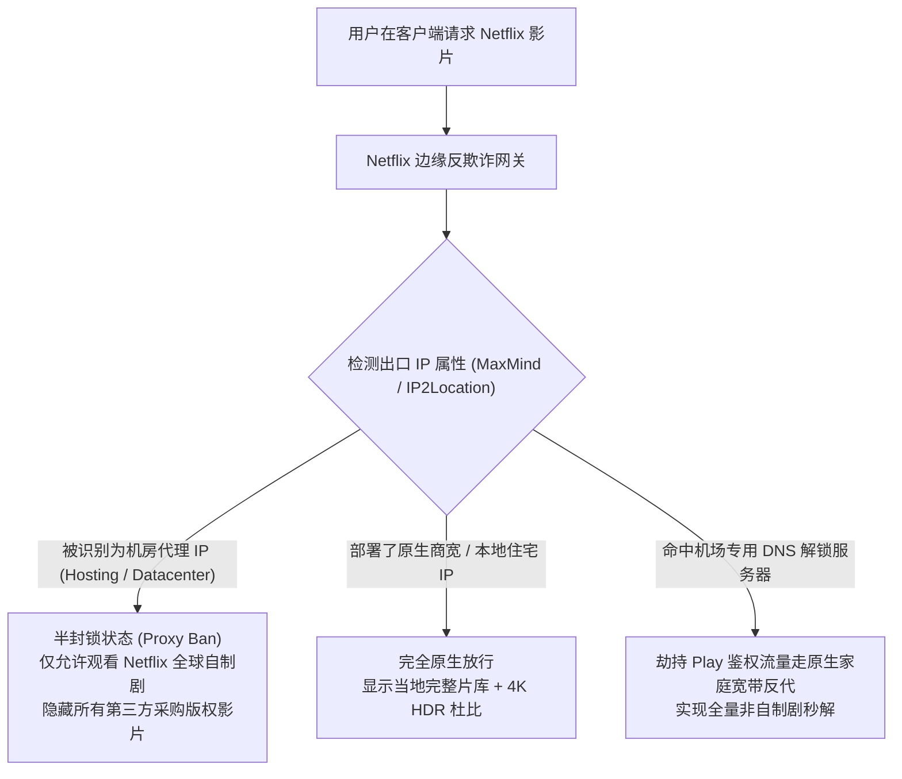

在海外流媒体追剧场景中，“网络通了”与“真正能看全部版权大片”完全是两个概念。很多新手在购买了某家机场后，常常遭遇以下令人沮丧的尴尬局面：

- 打开 Netflix（奈飞），发现片库里只有寥寥无几的《怪奇物语》《鱿鱼游戏》等官方自制剧，全网热播的非自制版权电影电视剧完全搜不到；
- 登录 Disney+（迪士尼+），页面直接弹窗红字报错：`Disney+ is not available in your region (Error 73)`，甚至连个人资料头像都无法加载；
- YouTube 开启 4K 画质时频繁转圈缓冲，且无法正常定位到阿根廷、土耳其或乌克兰享受 YouTube Premium 会员低价权益；
- 电视盒子（Apple TV、Google TV Chromecast）上的应用动辄提示“检测到代理或 VPN，请关闭后重试”。

**流媒体巨头对机房代理的封控严苛程度仅次于大语言模型。它们购买了全球最先进的 IP 风控商业库，对公有云数据中心 IP 实施常态化的流媒体封锁。**

本文由[龙猫机场](/)实测实验室结合 42 家主流机场在 Apple TV、PC 与移动端的多维度压测数据，为您带来一份专著级的 2026 流媒体追剧与解锁避坑指南。

---

## 核心速查：2026 稳定解锁主流流媒体的优质专线机场

| 推荐机场品牌 | 线路底层架构 | Netflix 4K 全绿解锁 | Disney+ 支持情况 | 节点带宽与晚高峰表现 | 评测与详情 |
| :--- | :--- | :--- | :--- | :--- | :--- |
| **[光速云 (GuangSu)](/airports/guangsu/)** | 广港 IEPL 双内网专线 | **全区全绿解锁（港/台/新/日/美）** | 极佳（无地区报错 73） | 香港实测 529Mbps，4K 秒开 | [查看深度评测](/blog/guangsu-cloud-review-2026/) |
| **[暮光加速](/airports/muguang/)** | 沪美/深港 IPLC 专线 | **全绿支持，美区片库极度纯净** | 极佳（支持 4K 杜比视界） | 新加坡 419Mbps，美西稳定 | [查看深度评测](/blog/muguang-cloud-review-2026/) |
| **[星岛梦](/airports/xingdaomeng/)** | IEPL 专线，不限设备 | **全绿支持，覆盖东南亚小众区** | 优秀（支持大家庭电视并发） | 香港 504Mbps，1.0x 真实倍率 | [查看深度评测](/blog/xingdaomeng-review-2026/) |
| **[微风网络](/airports/weifeng/)** | IEPL 专线 + VLESS 协议 | **支持主流亚太热门地区片库** | 优秀（适合学生党追剧） | 年付折合 7元/月，性价比高 | [查看深度评测](/blog/weifeng-net-review-2026/) |

> [!TIP]
> 更多 42 家机场的流媒体解锁与大模型连通性实时跑分图，请直接参阅本站**[机场节点测速与流媒体实时观测站](/speedtest)**。

---

## 一、 为什么你的 Netflix 只能看“自制剧”？技术原理全揭秘

许多用户不明白：为什么我明明能打开 Netflix，也看得到视频，为什么叫“没有完全解锁”？



### 1. 国际版权分发与“半封锁（Proxy Ban）”机制
Netflix 平台上的影视剧分为两类：
- **全球自制剧（Netflix Originals）：** 如《黑镜》《星期三》《爱，死亡和机器人》。Netflix 拥有全球独家版权，无论用户在哪个国家，甚至挂着普通机房代理，官方都允许播放；
- **第三方采购版权剧：** 如索尼、华纳兄弟、派拉蒙授权的经典电影（如《哈利·波特》《蝙蝠侠》《绝命毒师》）。版权方严格限定了播映地区（例如仅限美国或日本 IP 播放）。

当 Netflix 的安全系统检测到您的出口 IP 来自 AWS、阿里云、搬瓦工等机房数据中心时，由于受到好莱坞版权协议的严格约束，Netflix **会静默隐藏所有第三方采购版权影片，仅把自制剧展现给您**。这就是典型的“代理半封锁”现象。

### 2. 什么是 DNS 流媒体解锁？
高品质的专线机场通常采用“**高速专线传输 + 落地原生 DNS 智能反向代理**”的混合架构：
- 节点列表里的主力专线负责保障几百兆的大带宽传输；
- 当客户端向 `netflix.com` 或 `disneyplus.com` 发送版权鉴权请求时，机场后端的自定义 DNS 解析服务器会自动将鉴权请求拦截，并引流至当地具备纯正家庭宽带身份的住宅反代出口；
- 鉴权成功放行后，海量视频数据流依然经由高速专线传输，兼顾了“**100% 片库解锁**”与“**百兆 4K 极速秒开**”的双重优势。

---

## 二、 Disney+ 报错 73 与 403 根因剖析与排障

相比 Netflix，Disney+ 的反代理机制更为粗暴直接：
- **Error 73 (App unavailable in your location)：** 意味着您的节点 IP 被判定为未开通 Disney+ 的国家（如使用了香港、国内中转直连或未受支持的地区出口）；
- **Error 403 / 无法加载资料：** 意味着该 IP 在 Disney+ 的黑名单库中欺诈分过高，平台直接切断了与登录网关的 HTTPS 握手连接。

**解决方案：**
1. 切换至带有 `[流媒体/NF]` 明确标签的**新加坡、日本或美国**专线节点；
2. 确保客户端配置了正确的加密 DNS（DoH：`1.1.1.1` 或 `8.8.8.8`），杜绝本地电信/联通 DNS 劫持；
3. 清除 App 缓存或在无痕隐身窗口重新登录。

---

## 三、 客户端精准分流实操：让追剧流量自动走解锁节点

在使用代理客户端（如 **Clash Verge Rev** 或 **Shadowrocket**）时，切勿使用全局代理。建议在配置文件中追加专门的流媒体策略组，实现“看奈飞走香港原生、看迪士尼走新加坡、查资料走国内直连”的智能化体验：

```yaml
# 推荐追加的流媒体智能分流规则段
rules:
  # Netflix 专用分流规则
  - DOMAIN-SUFFIX,netflix.com,🎬 Netflix
  - DOMAIN-SUFFIX,netflix.net,🎬 Netflix
  - DOMAIN-SUFFIX,nflximg.net,🎬 Netflix
  - DOMAIN-SUFFIX,nflxvideo.net,🎬 Netflix
  - DOMAIN-KEYWORD,netflix,🎬 Netflix
  
  # Disney+ 专用分流规则
  - DOMAIN-SUFFIX,disneyplus.com,✨ Disney+
  - DOMAIN-SUFFIX,disney-portal.my.onetrust.com,✨ Disney+
  - DOMAIN-SUFFIX,dssott.com,✨ Disney+
  - DOMAIN-KEYWORD,disney,✨ Disney+
  
  # YouTube 专用分流规则
  - DOMAIN-SUFFIX,youtube.com,▶️ YouTube
  - DOMAIN-SUFFIX,googlevideo.com,▶️ YouTube
  - DOMAIN-SUFFIX,ytimg.com,▶️ YouTube
```

详细的客户端安装配置与 TUN 模式开启步骤，请参阅本站[《第三方代理客户端下载与配置中心》](/clients)。

---

## 四、 优选流媒体机场的核心考核 4 大法则

1. **晚高峰带宽吞吐必须达到 50Mbps 以上：** 播放 Netflix 4K HDR 视频的峰值码率约在 25-35Mbps 之间。如果机场在晚高峰丢包严重或限速，视频会自动降级为模糊的 720P 甚至 480P；
2. **运维团队具备流媒体主动解锁监控：** 流媒体巨头每周都会轮番封锁一批 IP，优秀的机场服务商（如[光速云](/airports/guangsu/)）具备自动化脚本，每隔几小时会自动轮换被封的落地 DNS；
3. **支持全平台多设备同时在线：** 特别是客厅有 Apple TV、电视盒子、平板等设备的用户，优先选用[星岛梦（不限设备）](/blog/xingdaomeng-review-2026/)或[暮光加速](/blog/muguang-cloud-review-2026/)；
4. **低倍率不偷跑：** 追一部 4K 剧集动辄消耗数十吉流量，坚决避开 3x/5x 虚高倍率节点。

---

## 五、 站内四层内链矩阵导航

- 🚀 **经过严格流媒体实测的专线品牌：**
  - [光速云 2026 深度评测：IEPL 双专线与香港 529Mbps 晚高峰实测](/blog/guangsu-cloud-review-2026/)
  - [暮光加速 2026 深度评测：企业级 IPLC 专线与原生美西出口](/blog/muguang-cloud-review-2026/)
  - [星岛梦 2026 深度评测：不限设备连接与 1.0x 真实倍率家庭专线](/blog/xingdaomeng-review-2026/)
  - [微风网络 2026 深度评测：7元/月平价 IEPL 专线入门首选](/blog/weifeng-net-review-2026/)
- 📚 **选购与防坑科普：**
  - [2026 优质机场选购防坑全指南](/blog/how-to-choose-reliable-airport-2026/)
  - [2026 AI 时代专线与原生 IP 指南](/blog/chatgpt-claude-airport-unlock-guide/)
- 🛠️ **工具与排障实战：**
  - [第三方代理客户端官方下载与配置中心](/clients)
  - [💡 机场百科与日常排障 100 问全能手册](/faq)
  - [42 家机场品牌综合知识库](/airports)
