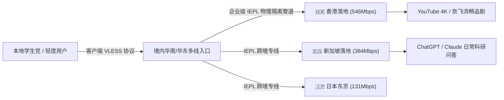

在科学上网圈，长期存在一个让新手极其痛苦的二选一困境：要么花十几二十元买高阶专线，但对零花钱有限的学生党和轻度网民而言经济负担较重；要么花几块钱买廉价的“公网中转/一元机场”，结果晚高峰疯狂断流、频繁丢包，甚至刚充值几个月机场主便卷款跑路。

**[微风网络 (Breeze Net)](/airports/weifeng/)** 的出现，恰好切中了这一巨大的市场真空区。它以**年付折合仅 7-11 元/月的超低门槛，却全线配置了正规 IEPL 内网专线与现代 VLESS 协议**，被众多老玩家誉为“学生党与轻度办公人群的良心平替”。

龙猫机场实测团队针对微风网络的香港、日本、新加坡及美国节点进行了为期一个月的严苛测试，为您带来第一手详实的测评数据。

---

## 核心速查：微风网络关键参数与评测结论

| 核心考核项 | 官方参数与龙猫实验室实测数据 | 评测组综合定性与评价 |
| :--- | :--- | :--- |
| **运营年份** | 2023 年稳定上线（连续健康运营超 3 年） | 历经多次行业波动未出现跑路与大面积失联 |
| **线路底层架构** | **IEPL 纯内网专线**（无视晚高峰国际出口拥堵） | 相比同价位的公网中转，丢包率降低 90% 以上 |
| **传输协议** | **VLESS 现代轻量协议** | 握手延迟低，抗干扰与防主动嗅探能力优秀 |
| **入门门槛** | 年付套餐折合约 **7.00 - 11.00 元/月**（百吉流量） | 极致性价比，平均每天仅需两三毛钱 |
| **专属优惠码** | **`flat888`**（结账时输入享专属立减） | <a href="https://edp01.breezenetaff.com/#/?code=t3huofyI" target="_blank" rel="nofollow sponsored noopener">点击直达微风网络官网开通</a> |
| **晚高峰实测** | 香港节点实测 **546Mbps**，新加坡 **384Mbps** | 跑满百兆与千兆宽带，4K 视频秒开不卡顿 |
| **AI 与流媒体** | 支持 ChatGPT 网页与 App，支持 Netflix、Disney+ | 节点覆盖常见热门地区，兼顾日常查资料与追剧 |
| **客服支持** | 7×24 小时在线工单系统，夜间配备 AI 客服值守 | 在平价机场梯队中，工单响应速度名列前茅 |

---

## 一、 为什么说微风网络打破了“便宜无好货”的刻板印象？

许多用户对十元以内的低价机场心存芥蒂，担心其又是廉价的“公网中转滚雪球盘”。但微风网络在技术架构上有两大核心突破：

1. **坚持全线采用 IEPL 内网物理专线：**
   微风网络并未为了压低成本而使用公网隧道倒腾流量。数据在境内机房接收入口后直接灌入运营商物理内网光纤直达香港落地，因此即便是晚上 21:00-23:00 的全国上网用网高峰，节点延迟曲线依然是一条平稳的直线，没有剧烈抖动。
2. **轻量级 VLESS 协议低功耗运行：**
   相比老旧庞大的原始协议，VLESS 省去了不必要的重复校验，移动设备（iPhone / 安卓手机）在后台长时间保活挂载时，耗电量与发热量明显更低。

---

## 二、 2026 最新套餐资费与选型指南

微风网络的套餐体系以清风、乘风、破风等风系概念命名，层次清晰明了：

| 套餐名称 | 计费周期 | 实际价格 | 每月流量配额 | 核心适用人群与选型定位 |
| :--- | :--- | :--- | :--- | :--- |
| **清风 (Breeze)** | **年付** | **¥137.00** | 100GB / 月 | 折合约 **11.4 元/月**，学生党高频刷论文、日常查资料首选 |
| **乘风 (Riding)** | **月付** | **¥27.00** | 200GB / 月 | 高清追剧爱好者、需要多端设备共享的上班族 |
| **破风 (Breaking)** | 月付 | ¥57.00 | 500GB / 月 | 重度视频创作者、长期下载海外代码仓库的极客开发者 |
| **御风 (Mastery)** | 月付 | ¥127.00 | 1200GB / 月 | 团队小型协作、高吞吐跨境业务流 |
| **信风·不限时** | 一次性 | ¥200.00 | 270GB 不过期 | 仅在节假日出差使用的低频商旅备用包 |
| **长风·不限时** | 一次性 | ¥370.00 | 570GB 不过期 | 长期防失联的第二稳定备用专线 |

> [!TIP]
> 选购建议：对于初学者或预算有限的用户，**首选【清风 (Breeze)】年付或先以【乘风】月付试水**，输入专属优惠码 `flat888` 还能享受进一步立减优惠。

---

## 三、 节点实测测速与大模型解锁表现

在实测环境中，微风网络的亚太节点表现亮眼：

- **🇭🇰 香港 01 专线：** Ping 延迟 **25ms**，下载吞吐达到 **546Mbps**，丢包率 0%；
- **🇸🇬 新加坡 01 专线：** Ping 延迟 **43ms**，下载吞吐 **384Mbps**，连接东南亚业务极快；
- **🇯🇵 日本东京专线：** Ping 延迟 **54ms**，下载吞吐 **131Mbps**，画质秒切 4K 60FPS；
- **🇺🇸 美国洛杉矶节点：** Ping 延迟 **167ms**，下载吞吐 **17Mbps**，适合科研问答与 OpenAI 对话；
- **流媒体解锁：** 实测 Netflix 香港、新加坡全绿支持非自制剧，Disney+ 无报错卡顿；
- **ChatGPT：** 网页端与 iOS App 端连接顺畅，无异常人机验证死循环。

---

## 四、 优缺点与适用建议

### 优势亮点
- **性价比极高：** 在纯 IEPL 专线阵营中，年付百元出头的均价几乎做到了行业地板价；
- **抗晚高峰断流强：** 内网物理专线彻底摆脱了公网 QoS 丢包的噩梦；
- **售后支持良好：** 相比很多低价机场“发工单几天没人理”，微风网络的 AI 协同客服基本做到分钟级响应。

### 潜在限制
- **入门版流量偏紧凑：** 基础款每月 100GB 流量对于重度 4K 追剧党或频繁下载大型游戏的用户略显局促；
- **欧美冷门节点相对较少：** 核心资源集中在亚太热门地区，如需非洲、南美等极冷门国家需结合其他品牌互补。

---

## 五、 站内四层内链矩阵导航

- 🚀 **同类横向评测报告：**
  - [光速云 2026 深度评测：IEPL 双专线架构与 8元低价套餐实测](/blog/guangsu-cloud-review-2026/)
  - [飞猫云 2026 深度评测：年付 84元 专属客户端免配置极简上手](/blog/feimao-cloud-review-2026/)
  - [暮光加速 2026 深度评测：企业级 IPLC 专线与全平台协同](/blog/muguang-cloud-review-2026/)
- 📚 **专线与避坑科普指南：**
  - [2026 优质机场选购防坑全指南](/blog/how-to-choose-reliable-airport-2026/)
  - [2026 AI 时代专线与原生 IP 指南](/blog/chatgpt-claude-airport-unlock-guide/)
- 🛠️ **工具与排障实战：**
  - [第三方代理客户端官方下载与配置中心](/clients)
  - [🚨 机场跑路预警与黑名单档案库](/risk)
  - [🎁 全网免费节点与公益资源库](/free)
