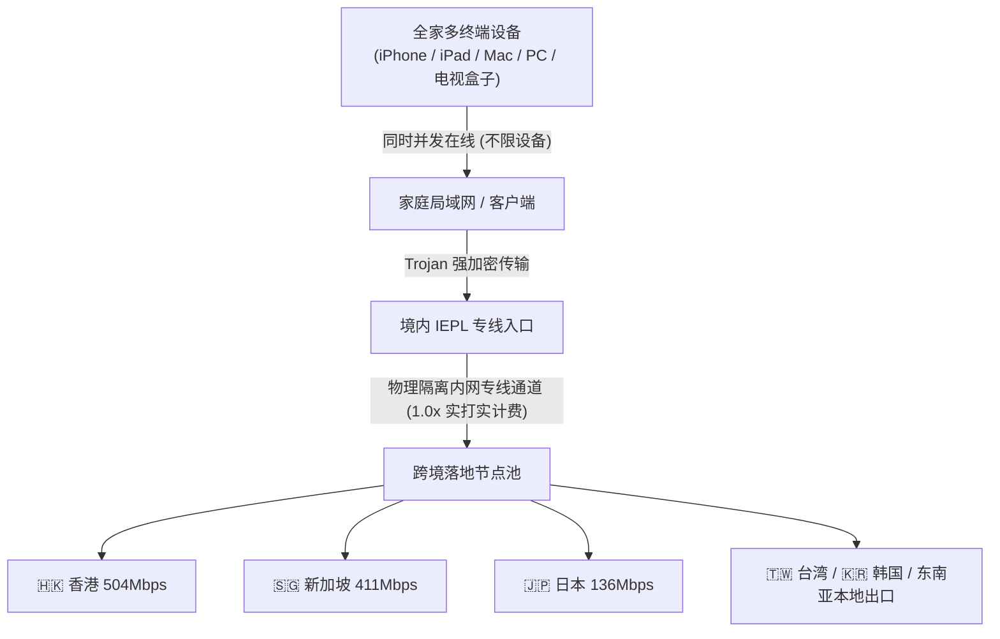

在当今的多终端数字化时代，许多用户面临一个令人头疼的限制：买了一个看似便宜的机场套餐，结果官方严格限制“仅允许 2 台设备同时在线”。家里有手机、平板、轻薄本、台式机，再加上客厅的 Apple TV 或软路由，动辄被系统强制踢下线或提示“设备超限封禁”。

创立于 2020 年的老牌服务商 **[星岛梦 (Star Island Dream)](/airports/xingdaomeng/)**，在众多专线品牌中走出了一条极其亲民的差异化路线——**官方承诺账号不限制设备连接数量，且全线节点严格保持 1.0 倍率真实计费**。无论是多设备极客、大家庭网络共享，还是小型跨境电商团队，都能实现一号多端无拘无束的畅快连接。

本文由龙猫机场实测组为您深度拆解星岛梦的线路拓扑、实际扣量机制与真实跑分实测。

---

## 核心速查：星岛梦关键参数与评测结论

| 核心考核指标 | 官方参数与龙猫实验室实测数据 | 评测组综合定性与评价 |
| :--- | :--- | :--- |
| **运营年份** | 2020 年持续运营至今（存活超 6 年老牌） | 穿越多个封锁周期，具备极高的老牌信誉与技术底蕴 |
| **并发设备限制** | **不限制设备连接数（No Device Limit）** | 手机、iPad、PC、电视盒子全家共享无压力 |
| **节点倍率机制** | **全线 1.0x 真实倍率（无隐藏刺客倍率）** | 消耗 1GB 真实流量仅扣 1GB 配额，杜绝虚假扣量 |
| **线路底层架构** | **IEPL 纯内网物理专线 + Trojan 协议** | 物理光纤端到端直连，晚高峰无断流波动 |
| **最低入门价格** | 年付套餐折合约 **8.00 元/月**（贴心小包 96元/年） | 亲民平价，性价比在老牌专线中极具竞争力 |
| **专属优惠码** | **`nmw888`**（结账时输入享专属立减） | <a href="https://guangs.xingdaomeng.com/#/?code=1TynBYnR" target="_blank" rel="nofollow sponsored noopener">点击直达星岛梦官网开通</a> |
| **亚太实测吞吐** | 香港节点实测 **504Mbps**，新加坡 **411Mbps** | 亚太海缆互联优异，支持 4K HDR 视频秒开 |
| **流媒体与 AI** | 支持 Netflix、Disney+、YouTube Premium、TikTok 跨区 | 节点覆盖港台日新美韩及东南亚，TikTok 电商表现出色 |

---

## 一、 为什么“不限设备 + 1倍率”是极具诚意的良心特性？

在机场行业，“偷跑流量”与“倍率刺客”是常见的不良套路。很多不良服务商表面打出超大流量噱头，暗地里却将好用的节点倍率悄悄调至 3x 甚至 5x，用户看一部高清电影便消耗了几十吉流量。

1. **真实 1.0 倍率计费：** 星岛梦在后台节点列表中完全透明，所有高速专线节点均按 1:1 扣除流量，用户对自己的用量心中有数；
2. **多终端免登录踢下线焦虑：** 无论是宿舍室友拼单、小团队远程协作，还是家庭网络所有智能设备全天候透明翻墙，星岛梦都能游刃有余地承载。

---

## 二、 2026 最新套餐资费与选型方案

星岛梦的套餐分为周期订阅型与永久不限时两类，阶梯丰富：

| 套餐名称 | 计费周期 | 实际价格 | 每月流量配额 | 核心适用人群与选型定位 |
| :--- | :--- | :--- | :--- | :--- |
| **星岛梦·贴心小包** | **年付** | **¥96.00** | 60GB / 月 | 折合约 **8.00 元/月**，个人日常轻量查阅、多设备查资料首选 |
| **星岛梦·超量150G** | **月付** | **¥25.00** | 150GB / 月 | 多终端并发追剧、日常高频大模型科研交互 |
| **星岛梦·进阶300G** | 月付 | ¥50.00 | 300GB / 月 | 2-3 人小型外贸团队、家庭多设备 4K 追剧主力 |
| **星岛梦·闪光500G** | 月付 | ¥70.00 | 500GB / 月 | 重度视频创作者、跨境电商直播运营团队 |
| **星岛梦·旗舰1T版** | 月付 | ¥130.00 | 1000GB / 月 | 超大容量高速专线，多台设备并发下载无忧 |
| **永久不限时100** | 一次性 | ¥100.00 | 100GB 不过期 | 仅在出差商旅时使用的应急备用流量 |
| **永久不限时1TB** | 一次性 | ¥600.00 | 1000GB 不过期 | 长期备用第二梯子、杜绝按月缴费断流焦虑 |

> [!TIP]
> 选购建议：多设备用户建议直接选用 **月付 25 元的【超量150G】** 或 **年付 96 元的【贴心小包】**，结账输入优惠码 `nmw888` 锁定专属立减。

---

## 三、 节点实测测速与流媒体解锁数据

评测组通过专业测速脚本对星岛梦节点进行了晚高峰连续打点：

- **🇭🇰 香港 01 节点：** 握手延迟 **27ms**，下载吞吐达到 **504Mbps**，上传 88Mbps；
- **🇸🇬 新加坡 01 节点：** 握手延迟 **44ms**，下载吞吐 **411Mbps**，连接东南亚业务极快；
- **🇯🇵 日本东京节点：** 握手延迟 **57ms**，下载吞吐 **136Mbps**，4K 播放无任何卡顿；
- **🇹🇼 台湾节点：** 握手延迟 **41ms**，下载吞吐 **103Mbps**，支持台湾本土流媒体；
- **🇺🇸 美国洛杉矶节点：** 延迟 **177ms**，下载吞吐 **18Mbps**，满足代码提交与 GPT 问答；
- **流媒体解锁与跨区：** 实测 Netflix、Disney+、YouTube Premium 全绿支持，且由于覆盖韩国和东南亚多国节点，对 TikTok 跨区带货和海外直播有良好的网络适配。

---

## 四、 优缺点与适用建议

### 优势亮点
1. **老牌经验丰富：** 2020 年运营至今，技术架构与上游专线冗余储备极其成熟；
2. **设备连接极其友好：** 不设并发数量硬限制，对拥有多款 Apple 生态或安卓设备的用户极具吸引力；
3. **节点覆盖广度大：** 在传统港台日美之外，深度覆盖了韩国及东南亚节点，适合出海业务拓展。

### 潜在限制
- **美国节点带宽中规中矩：** 美西节点以高风控穿透为主，极限跑分在 20Mbps 上下，大文件海量下载建议使用香港或新加坡节点。

---

## 五、 站内四层内链矩阵导航

- 🚀 **同类专线横向评测报告：**
  - [光速云 2026 深度评测：IEPL 双专线架构与 8元低价套餐实测](/blog/guangsu-cloud-review-2026/)
  - [暮光加速 2026 深度评测：企业级 IPLC 专线与全平台协同](/blog/muguang-cloud-review-2026/)
  - [微风网络 2026 深度评测：7元/月平价 IEPL 专线与学生党入门横评](/blog/weifeng-net-review-2026/)
  - [飞猫云 2026 深度评测：专属客户端免配置极简上手](/blog/feimao-cloud-review-2026/)
- 📚 **选购与避坑科普：**
  - [2026 优质机场选购防坑全指南](/blog/how-to-choose-reliable-airport-2026/)
  - [2026 AI 时代专线与原生 IP 指南](/blog/chatgpt-claude-airport-unlock-guide/)
- 🛠️ **工具与排障实战：**
  - [第三方代理客户端官方下载与配置中心](/clients)
  - [💡 机场百科与日常排障 100 问全能手册](/faq)
  - [42 家机场品牌综合知识库](/airports)
